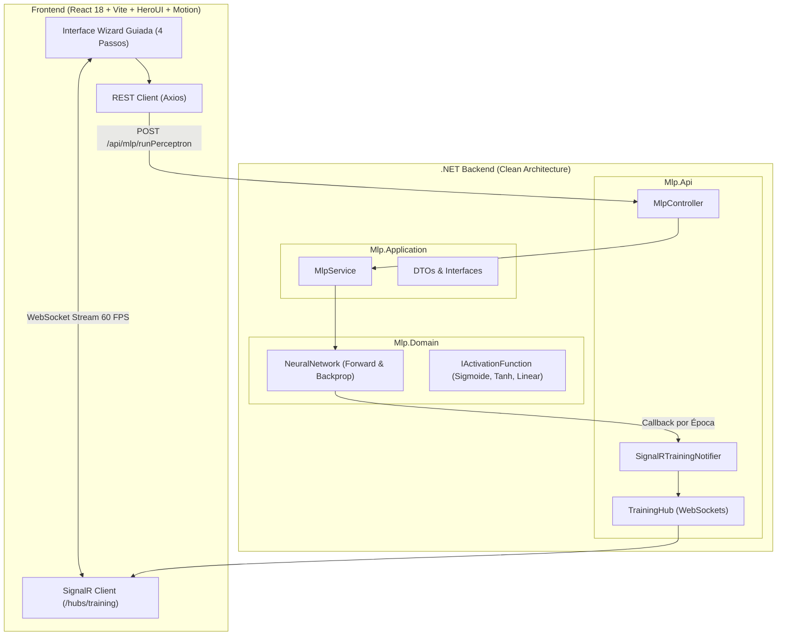
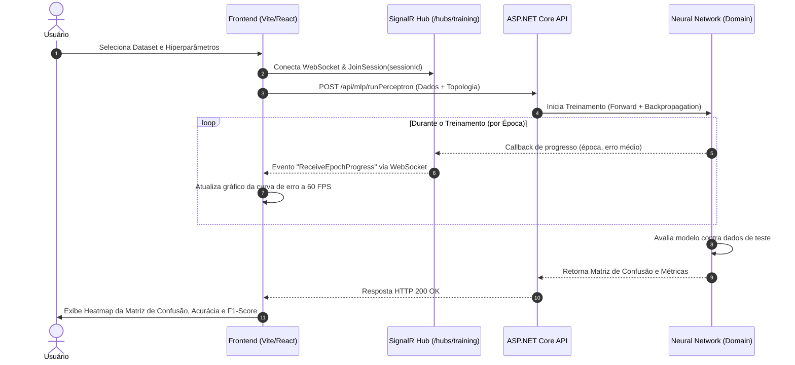

# 🧠 Real-Time MLP Neural Network Visualizer

<p align="center">
  
  
  
  
  
  
  
  
  
</p>

> **Aplicação Fullstack moderna para treinamento, visualização e avaliação didática de Redes Neurais Perceptron Multicamadas (Multi-Layer Perceptron), com algoritmo implementado do zero em C# (.NET Clean Architecture) e streaming em tempo real via WebSockets (SignalR) para frontend reativo em React/Vite com HeroUI, Motion e suporte completo a Docker.**

---

## 📑 Documentações Detalhadas do Projeto

Para explorar os detalhes arquiteturais, matemáticos e de código de cada camada, acesse os guias dedicados:

| Módulo | Documentação | Destaques Técnicos |
| :--- | :--- | :--- |
| **Backend** | ⚙️ [Documentação do Backend (.NET)](backend/README.md) | Clean Architecture estrita, álgebra matricial pura, Strategy Pattern nas funções de ativação, SignalR Hub e 16 testes automatizados xUnit. |
| **Frontend** | 🎨 [Documentação do Frontend (Vite/React)](frontend/README.md) | Vite 6, HeroUI v2.8, Motion (`motion.dev`), Wizard Stepper em 4 Passos, Diagrama SVG da Topologia, Modal Didático ("O que é MLP?") e Heatmap de Confusão. |
| **Licença** | 📄 [Licença de Uso (MIT)](LICENSE) | Termos de uso, distribuição e modificação livre. |

---

## 🎯 Por Que Esse Projeto se Destaca?

* **Rede Neural Desenvolvida do Zero (*From Scratch*):** Nada de bibliotecas prontas como *Scikit-Learn, TensorFlow ou PyTorch*. Todo o cálculo matricial, somatório ponderado, bias, retropropagação do gradiente (*Backpropagation*), shuffle estocástico (Fisher-Yates) e derivadas analíticas foram construídos em C# puro.
* **Arquitetura Corporativa de Alta Performance:** O backend segue rigorosamente a **Clean Architecture (Onion / Hexagonal)** com desacoplamento total entre Domínio, Casos de Uso e Apresentação, aplicando padrões **SOLID (Strategy, Factory, DIP)**.
* **Streaming em Tempo Real (WebSockets / SignalR):** Ao invés de travar a requisição esperando milhares de épocas terminarem, o servidor envia o erro de cada época via WebSocket a **60 FPS**, desenhando a curva de aprendizado dinamicamente enquanto a rede aprende.
* **Wizard Didático Guiado (4 Passos):** Interface estruturada em um Stepper intuitivo (*1. Dados ➔ 2. Arquitetura ➔ 3. Treino ao Vivo ➔ 4. Avaliação*), com cores pastéis educativas, diagrama interativo de neurônios em SVG e guia explicativo embutido.
* **Matriz de Confusão Interativa:** Mapa de calor com gradiente de intensidade de acertos (verde menta) e erros (coral), cálculo de acurácia global, precisão, recall e F1-score por classe.
* **Pronto para Docker (Containerizado):** Suba todo o ecossistema (backend + frontend Nginx) com um único comando `docker compose up --build`.

---

## 🏛️ Arquitetura do Sistema



---

## 📡 Fluxo de Execução e Streaming



---

## ✨ Funcionalidades Principais

### 1. 📊 Gestão de Datasets e Pré-processamento
* **Datasets Embutidos para Teste em 1 Clique:**
  * **Base Benchmark Clássica:** 827 amostras de treino + 352 amostras de teste dedicadas, 6 entradas e 5 classes (CA/CB/CC/CD/CE).
  * **Iris Dataset:** 150 flores com 4 atributos contínuos e 3 classes balanceadas (*Setosa, Versicolor, Virginica*).
  * **ColorBalls Dataset:** 400 amostras espaciais com 4 atributos de coordenadas e 4 classes.
* **Upload Personalizado de CSV:** Drag-and-drop com parsing instantâneo via **PapaParse** e tabela de pré-visualização.
* **Seletor de Papéis de Colunas:** Defina visualmente quais colunas são entradas (*inputs*), classes-alvo (*targets*) ou ignoradas.
* **Particionamento Flexível:** Alternador entre arquivo único particionável (ex: 70% treino / 30% teste) ou pares dedicados de arquivos CSV.

### 2. 🎛️ Estúdio de Arquitetura e Hiperparâmetros
* **Diagrama SVG Interativo da Rede:** Visualização gráfica real dos nós de entrada, camada oculta e saída com conexões interligadas.
* Seleção de Função de Ativação (*Strategy Pattern*):
  * **Logística (Sigmoide)** - Padrão recomendada para classificação One-Hot.
  * **Tangente Hiperbólica (Tanh)** - Centrada em zero.
  * **Linear** - Para valores contínuos.
* Sliders sincronizados para Taxa de aprendizado ($\eta$), limite de erro desejado ($E_{min}$) e limite máximo de épocas.

### 3. ⚡ Treinamento em Tempo Real com WebSockets
* Streaming bidirecional com reconexão automática e tolerância a falhas.
* Gráfico de perda desenhado com Canvas/Chart.js a **60 FPS** com buffer circular sem travamento do navegador.
* Linha de meta de erro ($E_{min}$) dinâmica no gráfico.
* Telemetria ao vivo: cronômetro, contador de épocas, taxa de redução de erro e status de convergência.

### 4. 📈 Avaliação Completa & Matriz de Confusão
* **Matriz de Confusão em Heatmap:** Blocos coloridos proporcionalmente à quantidade de amostras (verde menta para acertos na diagonal principal, coral para erros).
* **Métricas Detalhadas por Classe:** Cálculo automático de **Precisão**, **Recall (Sensibilidade)** e **F1-Score**.
* Cards de métricas globais: Acurácia Geral (%), Status de Convergência, Total de Épocas executadas e Erro Final (MSE).

---

## 🚀 Como Executar o Projeto

### Opção 1: Via Docker Compose (Recomendado - 1 Comando)

Caso tenha o Docker instalado na sua máquina:

```bash
docker compose up --build
```

> * **Frontend (Nginx):** Acesse em `http://localhost:3000`
> * **Backend (.NET API):** Acesse em `http://localhost:5134`

---

### Opção 2: Execução Local (Manual)

#### Pré-requisitos
* [.NET SDK 10.0 ou 9.0](https://dotnet.microsoft.com/download)
* [Node.js 18+](https://nodejs.org/)

#### 1. Iniciar o Backend (.NET)
Abra um terminal na pasta do backend:

```bash
cd backend
dotnet restore
dotnet run --project src/Mlp.Api
```

> A API iniciará escutando em `http://localhost:5134` (com o hub SignalR em `http://localhost:5134/hubs/training`).

#### 2. Iniciar o Frontend (Vite / React)
Abra um segundo terminal na pasta do frontend:

```bash
cd frontend
npm install
npm run dev
```

> Acesse a aplicação no seu navegador em: **`http://localhost:3000`**

---

## 🧪 Suíte de Testes Automatizados

### Testes Unitários do Backend (xUnit)
Cobre o domínio matemático, ativações, forward pass, retropropagação e validação de convergência:

```bash
cd backend
dotnet test
```

### Build e Verificação do Frontend
Valida a tipagem estrita TypeScript e gera o bundle de produção otimizado:

```bash
cd frontend
npm run build
```

---

## 📂 Estrutura do Repositório

```text
mlp-neural-network-visualizer/
├── docker-compose.yml              # Orquestração de containers (Frontend Nginx + Backend .NET)
├── LICENSE                         # Licença oficial MIT
├── README.md                       # Documentação principal e orquestração do monorepo
│
├── backend/                        # [C# / .NET 10] Clean Architecture
│   ├── Dockerfile                  # Multi-stage build .NET 10
│   ├── src/
│   │   ├── Mlp.Domain/             # Núcleo matemático puro (Rede Neural, Ativações, Bias, Backpropagation)
│   │   ├── Mlp.Application/        # Casos de uso, DTOs e abstrações
│   │   ├── Mlp.Infrastructure/     # Serviços de infraestrutura e datasets
│   │   └── Mlp.Api/                # ASP.NET Core Web API, Controllers e SignalR Hub
│   ├── tests/
│   │   └── Mlp.Domain.Tests/       # 16 Testes unitários com xUnit
│   └── README.md                   # ⚙️ Documentação técnica detalhada do backend
│
└── frontend/                       # [Vite + React 18 + TS + HeroUI + Motion]
    ├── Dockerfile                  # Multi-stage build Node 20 ➔ Nginx Alpine
    ├── nginx.conf                  # Proxy reverso para API e WebSockets SignalR
    ├── src/
    │   ├── components/             # Componentes modulares (layout, dataset, parameters, training, evaluation)
    │   ├── data/presets/           # Datasets embutidos (Benchmark Clássico, Iris, ColorBalls)
    │   ├── hooks/                  # Hooks reativos (useTrainingSession, useDataset, useTheme)
    │   ├── services/               # Clientes SignalR e REST API
    │   └── utils/                  # Normalização Min-Max, One-Hot e parsers
    ├── package.json
    └── README.md                   # 🎨 Documentação técnica detalhada do frontend
```

---

## 📄 Licença

Distribuído sob a licença **MIT**. Consulte o arquivo [LICENSE](LICENSE) para obter o texto completo da licença e termos de uso.
