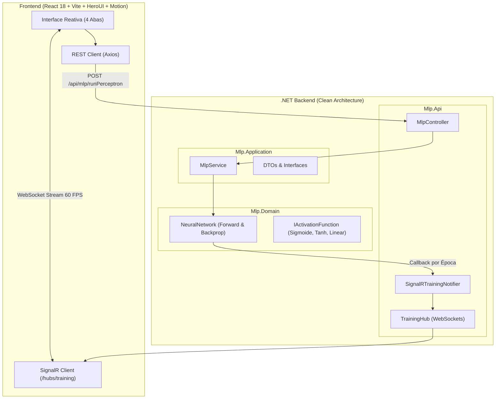
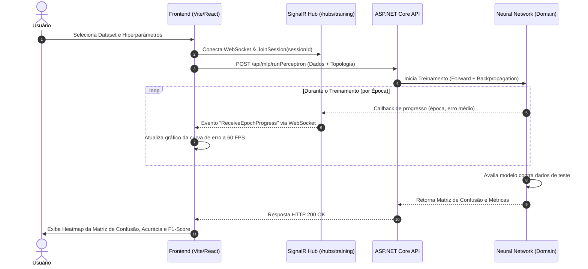

# 🧠 Real-Time MLP Neural Network Visualizer

<p align="center">
  
  
  
  
  
  
  
  
</p>

> **Aplicação Fullstack moderna para treinamento, visualização e avaliação interativa de Redes Neurais Perceptron Multicamadas (Multi-Layer Perceptron), com algoritmo implementado do zero em C# (.NET Clean Architecture) e streaming em tempo real via WebSockets (SignalR) para frontend reativo em React/Vite com HeroUI e Motion.**

---

## 📑 Documentações Detalhadas do Projeto

Para explorar os detalhes arquiteturais, matemáticos e de código de cada camada, acesse os guias dedicados:

| Módulo | Documentação | Destaques Técnicos |
| :--- | :--- | :--- |
| **Backend** | ⚙️ [Documentação do Backend (.NET)](backend/README.md) | Clean Architecture estrita, álgebra matricial pura, Strategy Pattern nas funções de ativação, SignalR Hub e 14 testes xUnit. |
| **Frontend** | 🎨 [Documentação do Frontend (Vite/React)](frontend/README.md) | Vite 6, HeroUI v2.8, Motion (`motion.dev`), streaming a 60 FPS com Canvas/Chart.js, Dark Mode e Heatmap da Matriz de Confusão. |
| **Licença** | 📄 [Licença de Uso (MIT)](LICENSE) | Termos de uso, distribuição e modificação livre. |

---

## 🎯 Por Que Esse Projeto se Destaca?

* **Rede Neural Desenvolvida do Zero (*From Scratch*):** Nada de bibliotecas de caixa-preta (*Scikit-Learn, TensorFlow ou PyTorch*). Todo o cálculo matricial, somatório ponderado, retropropagação do gradiente (*Backpropagation*) e derivadas analíticas foram construídos em C# puro.
* **Arquitetura Corporativa de Alta Performance:** O backend segue rigorosamente a **Clean Architecture (Onion / Hexagonal)** com desacoplamento total entre Domínio, Casos de Uso e Apresentação, aplicando padrões **SOLID (Strategy, Factory, DIP)**.
* **Streaming em Tempo Real (WebSockets / SignalR):** Ao invés de travar a requisição esperando milhares de épocas terminarem, o servidor envia o erro de cada época via WebSocket a **60 FPS**, desenhando a curva de aprendizado dinamicamente enquanto a rede aprende.
* **Interface Moderna e Fluida:** Construída com **Vite**, **React 18**, **HeroUI**, **Tailwind CSS** e **Motion (`motion.dev`)**, com suporte a tema Claro e Escuro, presets embutidos (Iris e ColorBalls) e drag-and-drop de arquivos CSV.
* **Matriz de Confusão Interativa:** Mapa de calor com gradiente de intensidade de acertos/erros, cálculo de acurácia global, precisão, recall e F1-score por classe.

---

## 🏛️ Arquitetura do Sistema



---

## 📡 Fluxo de Execução e Streaming



---

## ✨ Funcionalidades Principais

### 1. 📊 Gestão de Datasets e Pré-processamento
* **Datasets Embutidos para Teste em 1 Clique:**
  * **Iris Dataset:** 150 amostras, 4 entradas (comprimento/largura de pétala/sépala), 3 classes (*setosa, versicolor, virginica*).
  * **ColorBalls Dataset:** 400 amostras, 2 entradas contínuas, 4 classes.
* **Upload Personalizado de CSV:** Drag-and-drop com parsing instantâneo via **PapaParse** e tabela de pré-visualização.
* **Seletor de Papéis:** Defina visualmente quais colunas são entradas (*inputs*), classes-alvo (*targets*) ou ignoradas.
* **Pipeline de Normalização:** Escalonamento Min-Max $[0.0, 1.0]$ automático com proteção contra ordenação de chaves numéricas do motor V8.
* **Divisão Treino/Teste:** Slider dinâmico para particionar os dados (ex: 70% treino / 30% teste).

### 2. 🎛️ Estúdio de Hiperparâmetros
* Configuração visual da topologia:
  * Neurônios de Entrada
  * Neurônios da Camada Oculta
  * Neurônios de Saída
* Diagrama de arquitetura neural interativo.
* Seleção de Função de Ativação (*Strategy Pattern*):
  * **Logística (Sigmoide)**
  * **Tangente Hiperbólica (Tanh)**
  * **Linear**
* Taxa de aprendizado ($\eta$), limite de erro desejado ($E_{min}$) e número máximo de épocas.

### 3. ⚡ Treinamento em Tempo Real com WebSockets
* Streaming bidirecional com reconexão automática e tolerância a falhas.
* Gráfico de perda desenhado com Canvas/Chart.js a **60 FPS** com buffer circular e suporte a dezenas de milhares de épocas sem travamento.
* Linha de meta de erro ($E_{min}$) dinâmica no gráfico.
* Telemetria ao vivo: cronômetro em tempo real, contador de épocas, taxa de redução do erro e barra de progresso.

### 4. 📈 Avaliação Completa & Matriz de Confusão
* **Matriz de Confusão em Heatmap:** Células coloridas proporcionalmente à quantidade de amostras (verde para acertos, vermelho/alerta para erros).
* **Métricas Detalhadas por Classe:** Cálculo automático de **Precisão**, **Recall (Sensibilidade)** e **F1-Score**.
* Cards animados de métricas globais: Acurácia Geral (%), Status de Convergência, Total de Épocas executadas e Erro Final.

---

## 🚀 Como Executar o Projeto Localmente

### Pré-requisitos
* [.NET SDK 9.0 ou 10.0](https://dotnet.microsoft.com/download)
* [Node.js 18+](https://nodejs.org/)

---

### Passo 1: Iniciar o Backend (.NET)

Abra um terminal na pasta do backend:

```bash
cd backend
dotnet restore
dotnet run --project src/Mlp.Api
```

> A API iniciará escutando em `http://localhost:5134` (com o hub SignalR em `http://localhost:5134/hubs/training`).
> Para documentação técnica do backend, veja [backend/README.md](backend/README.md).

---

### Passo 2: Iniciar o Frontend (Vite / React)

Abra um segundo terminal na pasta do frontend:

```bash
cd frontend
npm install
npm run dev
```

> Acesse a aplicação no seu navegador em: **`http://localhost:3000`**
> Para detalhes dos componentes e serviços do frontend, veja [frontend/README.md](frontend/README.md).

---

## 🧪 Suíte de Testes Automatizados

### Testes Unitários do Backend (xUnit)
Cobre o domínio matemático, ativações, forward pass, retropropagação e serviços de aplicação:

```bash
cd backend
dotnet test
```

### Build e Verificação do Frontend
Valida a tipagem estrita TypeScript e gera o bundle de produção otimizado:

```bash
cd frontend
npm run build
```

---

## 📂 Estrutura do Repositório

```text
mlp-neural-network-visualizer/
├── LICENSE                         # Licença oficial MIT
├── README.md                       # Documentação principal e orquestração do monorepo
│
├── backend/                        # [C# / .NET 10] Clean Architecture
│   ├── src/
│   │   ├── Mlp.Domain/             # Núcleo matemático puro (Rede Neural, Ativações)
│   │   ├── Mlp.Application/        # Casos de uso, DTOs e abstrações
│   │   ├── Mlp.Infrastructure/     # Serviços de infraestrutura e datasets
│   │   └── Mlp.Api/                # ASP.NET Core Web API, Controllers e SignalR Hub
│   ├── tests/
│   │   └── Mlp.Domain.Tests/       # Testes unitários com xUnit
│   └── README.md                   # ⚙️ Documentação técnica detalhada do backend
│
└── frontend/                       # [Vite + React 18 + TS + HeroUI + Motion]
    ├── src/
    │   ├── components/             # Componentes modulares (dataset, parameters, training, evaluation)
    │   ├── data/presets/           # Datasets embutidos (Iris e ColorBalls)
    │   ├── hooks/                  # Hooks reativos (useTrainingSession, useDataset, useTheme)
    │   ├── services/               # Clientes SignalR e REST API
    │   └── utils/                  # Normalização Min-Max, One-Hot e parsers
    ├── package.json
    └── README.md                   # 🎨 Documentação técnica detalhada do frontend
```

---

## 📄 Licença

Distribuído sob a licença **MIT**. Consulte o arquivo [LICENSE](LICENSE) para obter o texto completo da licença e termos de uso.
