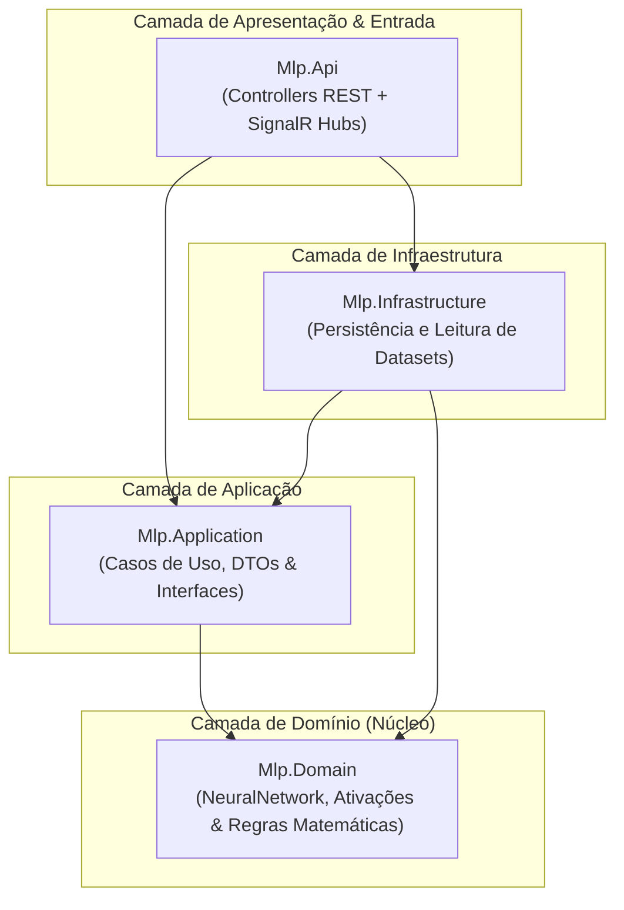
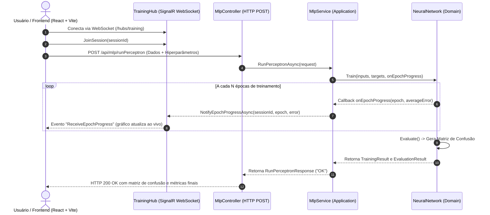

# 🧠 MLP Visualizer — Backend (.NET / C#)

> **API REST e Streaming em Tempo Real via WebSockets para Treinamento e Avaliação de Redes Neurais Perceptron Multicamadas (Multi-Layer Perceptron), implementada do zero em C# com Clean Architecture.**

---

## 📋 Sumário
- [Sobre o Projeto](#-sobre-o-projeto)
- [Principais Diferenciais Técnicos](#-principais-diferenciais-técnicos)
- [Arquitetura de Software (Clean Architecture)](#-arquitetura-de-software-clean-architecture)
- [Fluxo de Comunicação em Tempo Real](#-fluxo-de-comunicação-em-tempo-real)
- [Funções de Ativação (Strategy Pattern)](#-funções-de-ativação-strategy-pattern)
- [Documentação da API e Endpoints](#-documentação-da-api-e-endpoints)
  - [REST API](#rest-api)
  - [SignalR Hub (WebSockets)](#signalr-hub-websockets)
- [Pré-requisitos](#-pré-requisitos)
- [Como Instalar e Executar](#-como-instalar-e-executar)
- [Executando os Testes Automatizados](#-executando-os-testes-automatizados)
- [Estrutura de Pastas](#-estrutura-de-pastas)

---

## 💡 Sobre o Projeto

O **MLP Visualizer Backend** é o núcleo computacional responsável por executar o algoritmo de uma rede neural artificial **Multi-Layer Perceptron (MLP)** com propagação direta (*Forward Pass*) e retropropagação do erro (*Backpropagation*).

Diferente de projetos convencionais que utilizam bibliotecas prontas como TensorFlow, PyTorch ou ML.NET, **toda a álgebra, matrizes de pesos e cálculo de derivadas foram implementados puramente em C#**, permitindo controle absoluto do ciclo de aprendizado por época.

O grande diferencial é o suporte nativo a **comunicação bidirecional contínua**: a cada época processada, o backend emite métricas de erro em tempo real via **SignalR (WebSockets)**, permitindo que a interface gráfica plote a curva de aprendizado dinamicamente.

---

## ⚡ Principais Diferenciais Técnicos

* **Algoritmo do Zero (*From Scratch*):** Implementação manual de tensores/matrizes, cálculo de somatório ponderado ($net$), funções de transferência e retropropagação de gradiente.
* **Clean Architecture Estrita:** Separação rígida de responsabilidades entre Domínio, Aplicação e Infraestrutura/Apresentação.
* **Padrões de Projeto (SOLID):** Uso de *Strategy Pattern* e *Factory Pattern* para desacoplamento de funções matemáticas de ativação e *Dependency Inversion Principle (DIP)* para o notificador em tempo real.
* **Streaming por Época com SignalR:** Sem polling e sem bloqueio de I/O — atualizações assíncronas enviadas instantaneamente ao frontend.
* **100% Testado:** Suíte com **16 testes unitários automatizados** com **xUnit**, cobrindo convergência matemática, limites de funções, matriz de confusão e serialização.

---

## 🏛️ Arquitetura de Software (Clean Architecture)

O projeto foi estruturado seguindo o padrão de **Arquitetura Limpa**, onde a regra fundamental de dependência sempre aponta para o interior (núcleo de domínio):



### Responsabilidade de Cada Projeto:

| Camada | Projeto | Responsabilidade |
| :--- | :--- | :--- |
| **Domain** | `Mlp.Domain` | O núcleo puro. Contém a entidade `NeuralNetwork`, matrizes de pesos, cálculo de forward/backward, interfaces `IActivationFunction` e as classes concretas de ativação. Não possui nenhuma dependência externa. |
| **Application** | `Mlp.Application` | Orquestra os casos de uso. Contém o serviço `MlpService`, os DTOs de entrada e saída (`RunPerceptronRequest`, `RunPerceptronResponse`) e a abstração `ITrainingNotifier`. |
| **Infrastructure** | `Mlp.Infrastructure` | Lida com detalhes de baixo nível e fontes de dados externas (parsers de arquivos e datasets). |
| **Api** | `Mlp.Api` | A porta de entrada HTTP e WebSocket. Contém `MlpController`, o `TrainingHub` (SignalR), o `SignalRTrainingNotifier` e a configuração de injeção de dependência e CORS. |
| **Tests** | `Mlp.Domain.Tests` | 16 testes unitários automatizados com xUnit para validar o comportamento matemático, convergência e métricas de avaliação. |

---

## 📡 Fluxo de Comunicação em Tempo Real

A comunicação entre o cliente (navegador) e o servidor ocorre de forma híbrida: **REST** para disparar o treinamento e **WebSocket (SignalR)** para transmitir o progresso das épocas.



---

## 📐 Funções de Ativação (Strategy Pattern)

Para garantir total conformidade com o princípio Aberto/Fechado (*Open/Closed Principle* do SOLID), as funções de ativação implementam o contrato `IActivationFunction`:

```csharp
public interface IActivationFunction
{
    string Name { get; }
    double Activate(double net);
    double Derivative(double output);
}
```

Implementações nativas:
1. **Logística (Sigmoide):**
   $$f(x) = \frac{1}{1 + e^{-x}} \quad\implies\quad f'(x) = f(x) \cdot (1 - f(x))$$
2. **Tangente Hiperbólica ($\tanh$):**
   $$f(x) = \tanh(x) \quad\implies\quad f'(x) = 1 - f(x)^2$$
3. **Linear:**
   $$f(x) = \frac{x}{10} \quad\implies\quad f'(x) = \frac{1}{10}$$

Novas funções (como **ReLU** ou **LeakyReLU**) podem ser adicionadas criando uma nova classe sem necessidade de alterar o código da rede neural.

---

## 🔌 Documentação da API e Endpoints

### REST API

#### 1. Verificação de Saúde
* **Rota:** `GET /api/mlp/health`
* **Descrição:** Retorna o status de atividade da API.
* **Exemplo de Resposta (HTTP 200):**
```json
{
  "status": "Online",
  "message": "MLP Visualizer API está em execução.",
  "timestamp": "2026-10-23T19:00:00Z"
}
```

#### 2. Execução do Treinamento
* **Rota:** `POST /api/mlp/runPerceptron`
* **Content-Type:** `application/json`
* **Exemplo de Corpo de Requisição:**
```json
{
  "sessionId": "user-session-abc-123",
  "parameters": {
    "inputLayer": 4,
    "hiddenLayer": 3,
    "outputLayer": 3,
    "firstClassColumn": 4,
    "learningRate": 0.1,
    "errorValue": 0.01,
    "epochs": 1000,
    "transferFunction": "Logistica",
    "trainingRate": 0.7,
    "sameFileForTesting": true
  },
  "data": [
    { "sepalLength": 0.22, "sepalWidth": 0.62, "petalLength": 0.06, "petalWidth": 0.04, "setosa": 1, "versicolor": 0, "virginica": 0 },
    { "sepalLength": 0.16, "sepalWidth": 0.41, "petalLength": 0.06, "petalWidth": 0.04, "setosa": 1, "versicolor": 0, "virginica": 0 }
  ]
}
```
* **Exemplo de Resposta (HTTP 200):**
```json
{
  "message": "OK",
  "data": {
    "arrAvaregeError": [
      { "epoch": 1, "avarageError": 0.4521 },
      { "epoch": 10, "avarageError": 0.1235 },
      { "epoch": 100, "avarageError": 0.0098 }
    ],
    "confusionMatrix": [
      [15, 0, 0],
      [0, 14, 1],
      [0, 2, 13]
    ],
    "accuracyPercentage": 93.33,
    "totalEpochs": 100,
    "finalError": 0.0098,
    "converged": true
  }
}
```

---

### SignalR Hub (WebSockets)

* **URL de Conexão:** `ws://localhost:5000/hubs/training` (ou via protocolo HTTP negociado pelo SignalR client: `http://localhost:5000/hubs/training`).
* **Métodos Invocáveis pelo Cliente:**
  * `JoinSession(string sessionId)`: Vincula o socket à sessão de treino.
  * `LeaveSession(string sessionId)`: Desconecta o socket da sessão.
* **Eventos Emitidos pelo Servidor para o Cliente:**
  * `ReceiveEpochProgress`:
    ```json
    {
      "epoch": 40,
      "avarageError": 0.0452
    }
    ```

---

## 🛠️ Pré-requisitos

* [.NET SDK 9.0 ou 10.0+](https://dotnet.microsoft.com/download) instalado.
* Terminal PowerShell, Bash ou CMD.

---

## 🚀 Como Instalar e Executar

1. **Abra o terminal no diretório `backend/`:**
   ```bash
   cd backend
   ```

2. **Restaure as dependências dos projetos:**
   ```bash
   dotnet restore
   ```

3. **Compile a solução:**
   ```bash
   dotnet build
   ```

4. **Inicie o servidor Web API:**
   ```bash
   dotnet run --project src/Mlp.Api
   ```

O servidor iniciará escutando requisições em:
* HTTP: `http://localhost:5134` (ou a porta configurada no seu ambiente)
* Swagger/OpenAPI interativo (quando em modo Development): `http://localhost:5134/openapi/v1.json`

---

## 🧪 Executando os Testes Automatizados

O projeto conta com suíte de testes unitários abrangente cobrindo todas as operações críticas:

```bash
dotnet test
```

### Casos de Teste Inclusos:
* **Funções de Ativação:** Validação dos valores limite e de suas respectivas derivadas analíticas.
* **Factory de Ativação:** Resolução dinâmica de strings indiferentes a maiúsculas/acentos.
* **Validação do Domínio:** Lançamento de exceções controladas para topologias de rede inválidas.
* **Convergência de Treinamento:** Validação de aprendizado em problemas lógicos (ex: porta AND com queda monotônica de erro).
* **Callbacks de Época:** Verificação de disparo correto do notificador durante o treino.
* **Matriz de Confusão:** Teste de dimensionamento e acurácia.

---

## 📂 Estrutura de Pastas

```text
backend/
├── MlpVisualizer.slnx              # Arquivo de Solução .NET
├── README.md                       # Documentação técnica do backend
├── src/
│   ├── Mlp.Domain/                 # [Core] Entidades matemáticas e regras de negócio
│   │   ├── Activation/             # Interfaces e estratégias de ativação (Sigmoide, Tanh, Linear)
│   │   ├── Entities/               # NeuralNetwork.cs (Forward & Backpropagation)
│   │   └── Models/                 # Modelos de dados e métricas (EpochProgress, TrainingResult, etc.)
│   ├── Mlp.Application/            # [Casos de Uso] Orquestração e contratos
│   │   ├── DTOs/                   # Objetos de transferência de dados de entrada e saída
│   │   ├── Interfaces/             # Contratos de serviços e notificador em tempo real
│   │   └── Services/               # MlpService.cs (Treinamento, particionamento e avaliação)
│   ├── Mlp.Infrastructure/         # [Infraestrutura] Adaptadores e serviços externos
│   └── Mlp.Api/                    # [Apresentação] Porta de entrada REST e WebSocket
│       ├── Controllers/            # MlpController.cs (Endpoints REST)
│       ├── Hubs/                   # TrainingHub.cs (Hub SignalR)
│       ├── Services/               # SignalRTrainingNotifier.cs
│       └── Program.cs              # Configuração de CORS, DI e middlewares
└── tests/
    └── Mlp.Domain.Tests/           # Testes unitários automatizados (xUnit)
```
